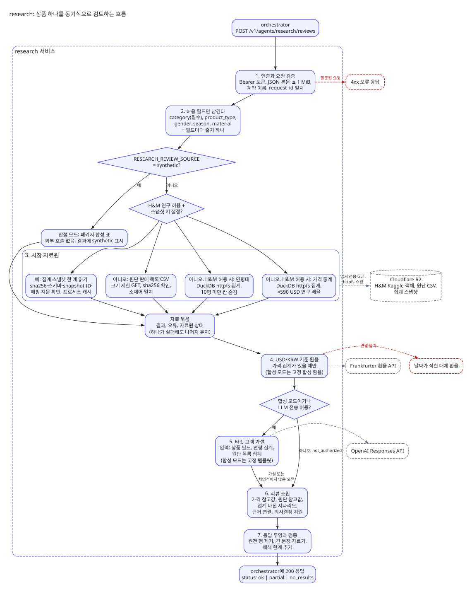

# fashion-planner-research

기획 중인 패션 상품을 판매·시장 자료로 검토하는 서비스입니다. 상품의 카테고리, 유형, 성별, 시즌, 소재를 받아 과거 판매가 통계, 고객 연령대, 원단 가격 참고값, 마진 시나리오, 그리고 선택적으로 타깃 고객 가설을 근거·한계와 함께 돌려줍니다.

> 이 레포는 **fashion-planner** 5개 레포 중 하나입니다. 전체 구조와 실행 방법은 [fashion-planner-orchestrator](https://github.com/KG-RAG-02/fashion-planner-orchestrator)에서 시작하세요.

| 레포 | 역할 |
|---|---|
| [fashion-planner-orchestrator](https://github.com/KG-RAG-02/fashion-planner-orchestrator) | 기획 질의 구조화, 6단계 워크플로 실행, 웹 UI, 기획서 PNG, Docker 통합 배포 |
| [fashion-planner-trend](https://github.com/KG-RAG-02/fashion-planner-trend) | Vogue Korea 기사에서 트렌드 추출, Neo4j 지식 그래프, 유사 상품 검색 |
| [fashion-planner-inventory](https://github.com/KG-RAG-02/fashion-planner-inventory) | 트렌드에 맞는 과잉재고 상품 매칭(규칙 + CLIP) |
| [fashion-planner-novelty](https://github.com/KG-RAG-02/fashion-planner-novelty) | 트렌드 기반 신상품(novelty) 기획안과 제품·착장 이미지 생성 |
| **[fashion-planner-research](https://github.com/KG-RAG-02/fashion-planner-research)** | **기획안의 판매·시장 조사(가격, 원단 원가, 고객 연령, 타깃)** |

이름의 "research"는 학술 연구가 아니라 이 판매·시장 검토를 뜻합니다.

## 개요

novelty가 상품 초안을 만들면, orchestrator가 그중 일부만 골라 research에 보냅니다. `category`(필수)와 `product_type`, `gender`, `season`, `material`(선택), 그리고 필드마다의 출처입니다. research는 다음을 수행합니다.

- 해당 카테고리·세그먼트의 H&M 과거 거래가 통계를 찾고, 평균을 원화 참고가로 바꿉니다.
- 그 카테고리를 산 고객의 연령대를 집계로만 보여 줍니다. 작은 집단은 숨깁니다.
- 소재와 맞는 공개 원단 판매 목록을 찾습니다.
- 업계 매출총이익률 기준을 마진 시나리오로 적용합니다.
- 허용된 경우에만 LLM에 타깃 고객 가설을 요청하고, 가설이라고 표시합니다.
- 근거 링크, 빠진 자료마다의 이유, 해석 한계를 함께 돌려줍니다.

숫자는 모두 코드로 계산하고, LLM은 가설 문장만 씁니다. research는 초안 전체나 제안가, 이미지를 받지 않고 결정도 하지 않습니다. 결정은 사람이 합니다.

## 아키텍처

<picture>
  <source media="(prefers-color-scheme: dark)" srcset="docs/diagrams/review-pipeline-dark.svg">
  
</picture>

무거운 H&M 집계는 오프라인에서 한 번 실행해 내용 해시로 이름 붙인 스냅샷 하나로 올립니다. 요청은 프로세스마다 그 객체를 한 번만 읽습니다. 자세한 내용은 [docs/architecture.md](docs/architecture.md)에 있습니다.

## 기능

- 인증이 필요한 경로 하나(`POST /v1/agents/research/reviews`)와 상태 점검 경로(`GET /api/health`)
- 허용 목록에 있는 입력만 받고, 필드마다 출처를 요구합니다. 모르는 필드는 거부합니다.
- 가격·연령·원단·마진 수치를 결정적으로 계산하고, 근거(`evidence`)마다 어느 결과 필드를 뒷받침하는지 적습니다.
- 부분 결과: 자료원 하나가 실패해도 나머지는 남고, 빠진 곳마다 `missing_data`에 이유를 적습니다.
- 집계만 내보냅니다. 고객 행이나 ID는 쿼리 밖으로 나가지 않고, 10명 미만 연령대가 있으면 그 프로필을 통째로 숨깁니다.
- H&M 자료 사용과 LLM 전송은 기본으로 꺼져 있고 env로만 켭니다.
- 스냅샷 빌더는 기존 객체를 덮어쓰지 않고, 빌드 중 자료원이 바뀌면 멈춥니다.
- 네트워크 없이 결정적인 결과를 내는 합성 리뷰 모드(`RESEARCH_REVIEW_SOURCE=synthetic`)
- 표준 라이브러리 HTTP 서버와 LLM 클라이언트. 필수 런타임 의존성이 없습니다.

## 빠른 시작(오프라인)

Python 3.11 이상이 필요합니다. 데이터, 클라우드 저장소, API 키 없이 실행됩니다.

```sh
git clone https://github.com/KG-RAG-02/fashion-planner-research
cd fashion-planner-research
python -m venv .venv && . .venv/bin/activate
pip install -e .
export FASHION_PLANNER_SERVICE_TOKEN=change-me
export RESEARCH_REVIEW_SOURCE=synthetic   # 합성 자료로 결과 모양을 확인합니다
fashion-planner-research                  # 127.0.0.1:8766
```

다른 터미널에서:

```sh
curl -s http://127.0.0.1:8766/v1/agents/research/reviews \
  -H "Authorization: Bearer $FASHION_PLANNER_SERVICE_TOKEN" \
  -H 'Content-Type: application/json' \
  --data-binary @contracts/examples/research-review.request.json
```

합성 모드에서는 `"status": "ok"`와 함께 가격·연령·원단·타깃 가설이 채워지고, `result.limitations`의 첫 항목이 합성 자료임을 알립니다. `RESEARCH_REVIEW_SOURCE`를 지우면 실제 자료원을 쓰며, 아무것도 설정하지 않았다면 `"status": "no_results"`와 자료원별 이유(`source_not_configured`, `source_not_configured_or_disabled`)가 옵니다. 실제 수치를 보려면 [docs/data.md](docs/data.md)의 자료를 준비하세요.

Docker:

```sh
cp .env.example .env            # FASHION_PLANNER_SERVICE_TOKEN을 채웁니다
docker compose up --build -d research
curl http://127.0.0.1:8766/api/health
```

## 설정

환경변수로 설정합니다. 레포 루트의 `.env`도 읽습니다(`RESEARCH_DISABLE_DOTENV=1`이면 읽지 않음).

| 변수 | 기본값 | 용도 |
|---|---|---|
| `FASHION_PLANNER_SERVICE_TOKEN` | 없음 | 리뷰 경로의 Bearer 토큰. `--service-mode`로 시작할 때 필수 |
| `RESEARCH_REVIEW_SOURCE` | 없음 | `synthetic`이면 네트워크 없이 합성 자료로 리뷰 |
| `RESEARCH_HM_NONCOMMERCIAL_RESEARCH` | `false` | H&M 자료 읽기. 비상업 연구일 때만 `true` |
| `RESEARCH_TARGET_LLM_TRANSFER_AUTHORIZED` | `false` | 가설 입력을 LLM 제공자에게 보내도록 허용 |
| `LLM_API_KEY`, `LLM_MODEL` | 없음 | 타깃 가설용 OpenAI Responses API 키와 모델 |
| `R2_ACCOUNT_ID`, `R2_BUCKET`, `R2_ACCESS_KEY_ID`, `R2_SECRET_ACCESS_KEY` | 없음 | 읽기 전용 객체 저장소(Cloudflare R2) |
| `R2_ENDPOINT` | 계정 ID로 계산 | HTTPS 저장소 엔드포인트를 직접 지정 |
| `RESEARCH_AGGREGATE_SNAPSHOT_KEY` | 없음 | H&M·원단 자료를 미리 만든 스냅샷 하나에서 읽기 |
| `RESEARCH_AGGREGATE_SNAPSHOT_PREFIX` | `derived/research-aggregate-snapshots` | 스냅샷 빌더가 올리는 위치 |
| `RESEARCH_R2_SOURCE_MANIFEST` | 패키지 매니페스트 | 자기 객체 키 매니페스트 파일 경로 |
| `RESEARCH_USD_KRW_FALLBACK_RATE`, `RESEARCH_USD_KRW_FALLBACK_DATE` | `1334.71`, `2026-11-12` | 환율 API에 닿지 않을 때 쓰는 환율 |
| `RESEARCH_CACHE_DIR` | `/tmp` | DuckDB 임시 파일의 기준 디렉터리 |
| `RESEARCH_AGE_DUCKDB_THREADS`, `RESEARCH_AGE_DUCKDB_MEMORY_LIMIT`, `RESEARCH_AGE_DUCKDB_TEMP_DIRECTORY` | `1`, `3GB`, `<cache>/duckdb-age-tmp` | 집계용 DuckDB 한도 |
| `RESEARCH_HTTPFS_TIMEOUT_SECONDS`, `RESEARCH_HTTPFS_RETRIES` | `20`, `1` | DuckDB `httpfs` 제한 시간(5–120)과 재시도(0–5) |
| `RESEARCH_DUCKDB_EXTENSION_DIRECTORY` | DuckDB 기본값 | DuckDB가 `httpfs`를 찾는 위치 |
| `RESEARCH_AGGREGATE_UPLOAD_ENABLED` | `false` | 스냅샷 빌더의 `--upload` 허용 |

저장소 기능을 쓰려면 `pip install -e '.[r2]'`로 설치합니다.

## 데이터

이 레포에는 데이터가 없고, MIT 라이선스는 코드에만 적용됩니다. H&M 데이터셋은 비상업 용도로만 쓸 수 있고 재배포할 수 없습니다. 원단 판매 목록 CSV는 직접 준비해야 합니다. 출처, 이용 조건, 스키마, 스냅샷 빌더는 [docs/data.md](docs/data.md)에 있습니다.

## API와 계약

| 경로 | 용도 |
|---|---|
| `POST /v1/agents/research/reviews` | 동기식 리뷰 한 건. Bearer 토큰 필요 |
| `GET /api/health` | 살아 있는지와 실행 모드(`local-development` 또는 `container-service`)만 알려 줌 |

- 요청·응답·오류 스키마: [`contracts/schemas/`](contracts/schemas/)
- 예시: [`contracts/examples/`](contracts/examples/)
- 필드와 status 설명: [`contracts/README.md`](contracts/README.md)

서비스 간 계약의 기준 사본은 orchestrator 레포에 있습니다.

## 프로젝트 구조

```
src/fashion_planner_research/
  http_server.py          경로, 요청 검증, 리뷰 한 건 처리
  runtime_settings.py     정책 스위치, 대체 환율
  domain/                 리뷰 조립, 마진 시나리오, 환율 환산
  llm/                    Responses API 클라이언트, 타깃 고객 가설
  sources/                객체 저장소, 원단 목록, H&M 집계·스냅샷, 합성 리뷰 소스
  resources/              카테고리 매핑, 자료원 매니페스트, 프롬프트, 합성 표
contracts/                JSON Schema와 예시
docs/                     아키텍처, 데이터, 설계 결정, 문제 해결, 다이어그램
tests/                    합성 데이터를 쓰는 오프라인 단위 테스트
scripts/                  테스트 실행, 다이어그램 생성·검사
```

## 테스트

```sh
pip install -e '.[r2,test]'
python scripts/run_tests.py
```

모든 테스트는 합성 데이터와 가짜 저장소 클라이언트로 오프라인에서 돌아갑니다. `r2` extra 없이 설치하면 DuckDB로 실제 집계 쿼리를 돌리는 테스트 1개만 건너뜁니다. CI도 같은 명령을 씁니다. Docker로는 `docker compose --profile test run --rm research-tests`를 씁니다.

다이어그램은 `scripts/render_diagrams.sh`로 `docs/diagrams/src/`에서 다시 만들고, `python scripts/check_diagram_claims.py`로 모든 요소를 코드와 대조합니다.

## 문제 해결과 교훈

DuckDB 메모리 한도부터 한국어 카테고리 이름까지 겪은 문제와 배운 점은 [docs/troubleshooting.md](docs/troubleshooting.md)에, 설계 결정은 [docs/decisions/](docs/decisions/)에 있습니다.

## 한계

- H&M 자료는 한 소매업체의 과거(2018–2020) 자료입니다. 여러분의 고객이나 지금의 수요가 아닙니다.
- 가격의 ×590 USD 배율은 가정이며 데이터셋의 통화 정보가 아닙니다.
- 성별 필터는 고객 성별이 아니라 상품 세그먼트 기준입니다. 시즌 정보는 없습니다.
- 원단 가격은 공개 판매가 참고값이며 조달 원가가 아닙니다.
- 마진은 업계 기준 시나리오이며 이 상품의 실제 마진이 아닙니다.
- 타깃 고객 문장은 제한된 입력으로 만든 가설입니다.
- 캐시는 프로세스마다 따로 있습니다. 복제본 사이에 공유하지 않습니다.

## 감사의 말

- Kaggle의 [H&M Personalized Fashion Recommendations](https://www.kaggle.com/competitions/h-and-m-personalized-fashion-recommendations): 대회 규칙에 따라 비상업 연구에 사용했습니다.
- NYU Stern Aswath Damodaran의 *Margins by Sector (US)*: 의류 매출총이익률 기준
- [Frankfurter](https://frankfurter.dev): USD/KRW 기준 환율
- [DuckDB](https://duckdb.org), [boto3](https://github.com/boto/boto3)
- 다이어그램은 Graphviz와 [Pretendard](https://github.com/orioncactus/pretendard)(SIL Open Font License 1.1)로 그렸습니다. 글꼴 파일은 레포에 넣지 않았습니다.
- 코드와 문서 일부는 AI(Claude)의 도움을 받아 작성했고, 해당 커밋에 그 사실을 적었습니다.

## 고지

- 이 프로젝트는 학습·교육 목적의 비상업 프로젝트입니다. Condé Nast, Vogue Korea(두산매거진), 무신사, H&M과 관련이 없으며 이들의 승인이나 후원을 받지 않았습니다. 'Vogue'는 해당 권리자의 상표입니다.
- 이 레포에는 제3자 데이터(기사 원문, 이미지, 상품·거래 데이터)가 들어 있지 않습니다. 데이터를 직접 받아 쓰는 경우 각 출처의 이용약관을 따라야 합니다. 자세한 내용은 `docs/data.md`를 보세요.

## 라이선스

코드는 [MIT 라이선스](LICENSE)로 배포합니다. MIT 라이선스는 이 레포의 코드에만 적용되며, 외부 데이터셋과 그 파생물에는 적용되지 않습니다.
