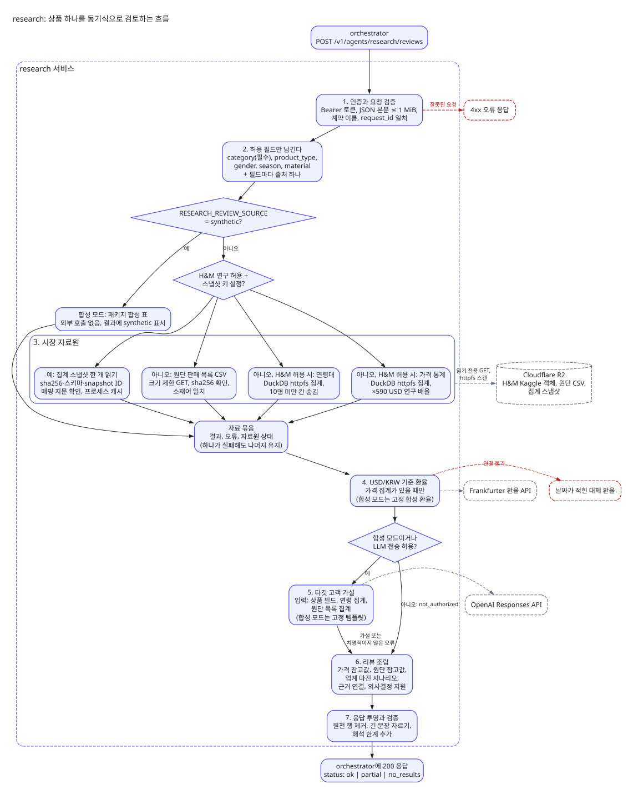
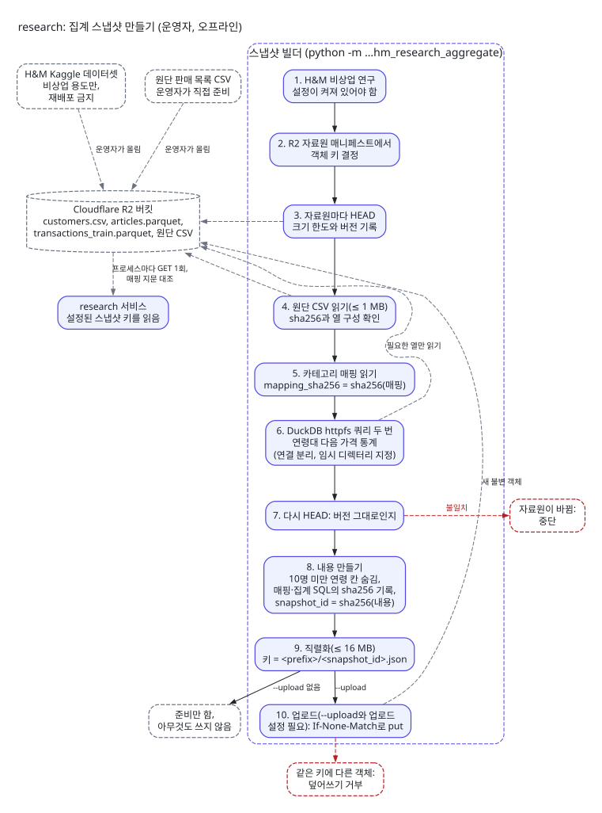

# 아키텍처

`fashion-planner-research`는 기획 중인 패션 상품을 시장 근거로 검토합니다. 리뷰 경로 하나를 가진 HTTP 서비스 하나입니다. 상품을 기획하거나 초안을 고치거나 결정을 내리지 않습니다. 최종 판단은 사람이 합니다.

## Fashion Planner 안에서의 위치

```
orchestrator ──► trend, inventory ──► novelty(초안) ──► orchestrator
                                                          │ 허용된 상품 필드
                                                          ▼
                                                       research ──► 리뷰 응답
```

orchestrator가 novelty 초안으로 요청을 만듭니다. research는 아래 상품 필드와 필드별 출처만 받습니다. 초안 전체, 제안가, 원가표, 이미지는 받지 않고, 다른 서비스를 호출하지도 않습니다.

## 리뷰 흐름

<picture>
  <source media="(prefers-color-scheme: dark)" srcset="diagrams/review-pipeline-dark.svg">
  
</picture>

1. **인증과 요청 검증**(`http_server.py`). Bearer 토큰을 상수 시간으로 비교하고, `Content-Type: application/json`, 최대 1 MiB 본문, 지원하는 계약 이름(`research-handoff`), 바깥과 `input`의 같은 `request_id`를 확인합니다.
2. **허용 필드만 남깁니다.** `category`(필수), `product_type`, `gender`(`women`, `men`, `unisex`, `unknown`), `season`, `material`, 그리고 보낸 필드마다 출처(`kind`, `source_ref`, `evidence_ids`) 하나. 모르는 필드는 거부합니다. orchestrator는 다섯 필드를 모두 보내고, novelty 초안에 값이 없거나 넘길 수 없는 `kind`이면 대체값(`product_type`=카테고리, `gender`=`unknown`, `season`=초안 시즌 또는 `미정`, `material`=`혼방 소재`)을 `kind: proposal`로 넣습니다. research는 출처(`product_evidence`)를 형식만 검사하고 리뷰 계산에는 쓰지 않습니다. 그래서 `proposal`인 대체값도 다른 값과 똑같이 자료 선택에 쓰입니다(예: `material`=`혼방 소재`로 원단 판매 목록을 맞춥니다). 결과를 읽을 때는 요청의 출처를 함께 보세요.
3. **시장 자료원을 읽습니다**(`sources/`). [자료원 모드](#자료원-모드)를 보세요.
4. **환율을 적용합니다**(`domain/currency_conversion.py`). 과거 가격 집계가 있을 때만 Frankfurter에서 USD/KRW 기준 환율을 가져오고, API에 닿지 않으면 날짜가 적힌 대체 환율을 씁니다.
5. **타깃 고객 가설**(`llm/target_audience.py`). LLM 전송이 허용됐을 때만 만듭니다. [ADR 0001](decisions/0001-deterministic-figures-llm-for-hypotheses-only.md)을 보세요.
6. **리뷰를 조립합니다**(`domain/sales_market_review.py`). 가격 참고값(평균 × 590을 USD로 보고 환산한 뒤 1,000원 단위 반올림), 원단 판매 목록 참고값, 업계 매출총이익률 시나리오(`domain/apparel_costing.py`), `supports_fields`가 붙은 근거, 빠진 이유, 오류, 한계, 의사결정 지원을 만듭니다.
7. **응답을 투영하고 검증합니다.** 원천 행과 판매 목록 개별 기록을 빼고, 긴 가설 문장을 자르고, 해석 한계를 덧붙인 뒤 계약에 맞는지 확인하고 보냅니다.

## 자료원 모드

<picture>
  <source media="(prefers-color-scheme: dark)" srcset="diagrams/snapshot-build-dark.svg">
  
</picture>

| 모드 | 조건 | 요청이 읽는 것 |
|---|---|---|
| 스냅샷 | H&M 연구 허용, `RESEARCH_AGGREGATE_SNAPSHOT_KEY` 설정 | 프로세스마다 JSON 객체 하나를 검증하고 캐시([ADR 0002](decisions/0002-precomputed-aggregate-snapshot.md)) |
| 원본 객체 | H&M 연구 허용, 스냅샷 키 없음 | 원단 CSV, 그리고 DuckDB `httpfs`로 계산한 연령·가격 집계를 병렬로 |
| 원단만 | H&M 연구 꺼짐 | 저장소가 설정돼 있으면 원단 CSV. H&M 자료원은 `source_not_configured_or_disabled` |
| 합성 | `RESEARCH_REVIEW_SOURCE=synthetic` | 패키지에 든 합성 표. 저장소·환율 API·LLM을 호출하지 않고 결과에 synthetic을 표시 |

스냅샷 빌더와 H&M 자료원은 [data.md](data.md)에 설명합니다.

## 응답

응답 봉투에는 `contract_version`(`research-handoff`), `request_id`, `producer`(`agent_id: research`, `schema_version: 1.0.0`), `status`, `result`가 있습니다. 카테고리 매핑을 쓴 결과에는 매핑 내용의 `mapping_sha256`이 붙어, 어떤 매핑으로 계산했는지 알 수 있습니다.

| `result` 필드 | 내용 |
|---|---|
| `category_price_comparison`, `price_analysis` | H&M 과거 가격 통계와 원화 참고가 |
| `material_cost_analysis`, `fabric_cost_analysis` | 원단 판매 목록 참고값. 검증된 조달 원가가 아닙니다 |
| `customer_segment_analysis` | 과거 연령대 집계 |
| `target_audience`, `target_audience_analysis` | 선택적 가설과 그 연령 근거. LLM을 불렀다면 쓴 시스템 프롬프트의 `prompt_sha256` |
| `margin_estimate`, `margin_analysis`, `margin_price_range_analysis` | 업계 기준 시나리오. 이 상품의 마진이 아닙니다 |
| `evidence` | 자료원마다 하나, `supports_fields` 포함 |
| `missing_data`, `errors`, `limitations` | 빠진 이유, 치명적이지 않은 실패, 해석 한계 |
| `decision_support` | 어떤 근거 영역이 채워졌는지, 지금 사람이 판단할 수 있는지 |

status는 `ok`(해당하는 자료원이 모두 근거를 냄), `partial`(근거와 함께 빈 곳이나 오류가 있음), `no_results`(상품에 맞는 근거가 없음) 중 하나입니다. [ADR 0006](decisions/0006-preserve-partial-results.md)을 보세요. 요청 오류와 서비스 오류는 HTTP 상태 코드와 `error` 객체로 알립니다. JSON Schema는 `contracts/`에 있습니다.

## 정책 스위치

배포자의 동의가 필요한 동작 두 가지는 기본으로 꺼져 있습니다([ADR 0005](decisions/0005-aggregates-only-and-opt-in-data-gates.md)).

- `RESEARCH_HM_NONCOMMERCIAL_RESEARCH`: H&M 자료를 비상업 연구 목적으로 읽습니다.
- `RESEARCH_TARGET_LLM_TRANSFER_AUTHORIZED`: 가설 입력을 모델 제공자에게 보냅니다.

## 캐시와 한도

| 대상 | 위치 | 한도 |
|---|---|---|
| 집계 스냅샷 | 프로세스 메모리 | 4개. 버킷, 키, 매핑 해시로 구분 |
| 원단 객체 / 분석 결과 | 프로세스 메모리 | 객체 4개 / 분석 256개 |
| 원본 모드의 연령·가격 결과 | 프로세스 메모리 | 자료원 버전 4개 / 256개 |
| 타깃 가설 | 프로세스 메모리 | 64개, 300초. 같은 호출이 동시에 오면 한 번만 요청 |
| 요청 본문 | HTTP 처리기 | 1 MiB |
| 저장소 클라이언트 | boto3 | 연결 5초, 읽기 30초, 최대 2회 시도 |
| DuckDB `httpfs` | 연결마다 | 제한 시간 5–120초(기본 20), 재시도 0–5회(기본 1) |
| 환율 API | `urllib` | 8초, 실패하면 날짜가 적힌 대체 환율 |
| LLM 호출 | `urllib` | 120초, 재시도 없음 |

캐시는 프로세스마다 따로 있습니다. 복제본이 여럿이면 사본도 여럿입니다.

한 요청 안에서 저장소, 환율, LLM을 차례로 부르므로, 실데이터 모드에서 타깃 가설까지 켜면 최악의 경우 약 200초가 걸립니다(추정: 저장소 (5+30)×2, 환율 8, LLM 120초). 호출하는 쪽의 읽기 제한은 이보다 길어야 합니다. orchestrator는 research 호출에만 210초를 씁니다.

## 보안

- `--service-mode` 없이 시작하면 `127.0.0.1`에만 묶입니다. `--service-mode`는 `0.0.0.0`에 묶고, 서비스 토큰이 없으면 시작하지 않습니다.
- 토큰은 `hmac.compare_digest`로 비교합니다. health 경로는 토큰이 필요 없고, 살아 있는지와 실행 모드만 알려 줍니다.
- 요청 처리 중에는 저장소를 읽기만 합니다. 쓰기는 스냅샷 빌더만, `--upload`와 별도 설정이 모두 있을 때만 합니다.
- 컨테이너는 UID 10001로, 읽기 전용 루트 파일시스템에서 실행합니다. 캐시와 DuckDB 임시 파일용 볼륨만 쓸 수 있습니다.
- 로그에는 단계, 소요 시간, 예외 클래스 이름만 남기고 요청 내용이나 자격 증명은 남기지 않습니다.

## 코드 지도

| 경로 | 역할 |
|---|---|
| `http_server.py` | 경로, 검증, 리뷰 한 건의 전체 처리, 응답 투영 |
| `runtime_settings.py` | 정책 스위치, 날짜가 적힌 대체 환율 |
| `domain/sales_market_review.py` | 리뷰 조립, 근거 연결, status |
| `domain/apparel_costing.py` | 마진 시나리오와 가격 범위 분석 |
| `domain/currency_conversion.py` | USD/KRW 기준 환율과 환산 |
| `llm/` | Responses API 클라이언트, 타깃 고객 가설 |
| `sources/shared/` | 읽기 전용 객체 저장소 클라이언트, 자료원 매니페스트 |
| `sources/market/fabric_price_r2_source.py` | 원단 판매 목록 참고값 |
| `sources/sales/hm_kaggle/` | 연령대, 가격 통계, 스냅샷 빌더와 읽기, 자료원 조정 |
| `resources/` | 카테고리 매핑, 자료원 매니페스트, 프롬프트 |
